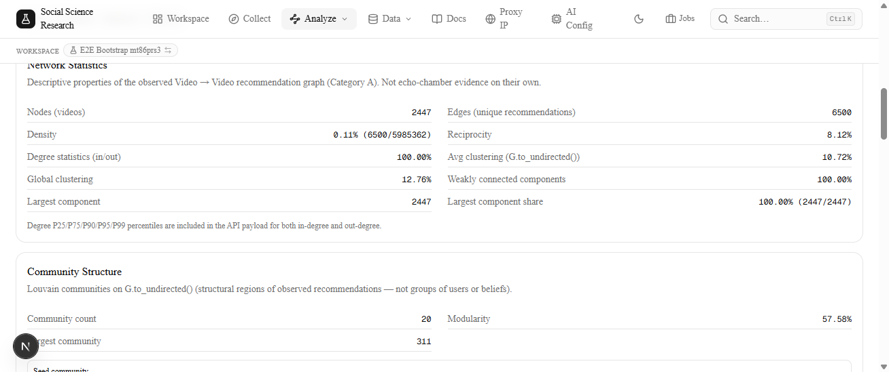
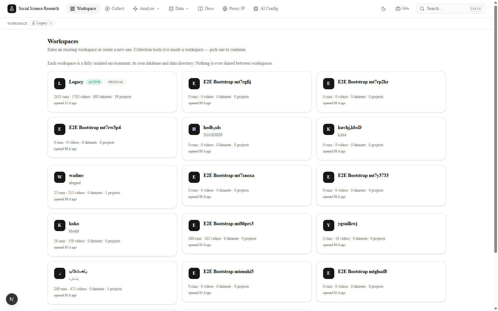
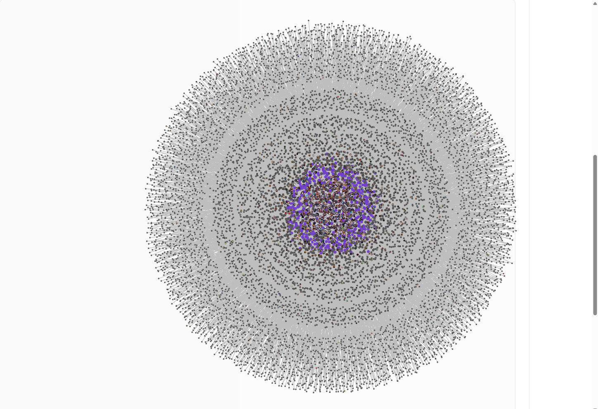
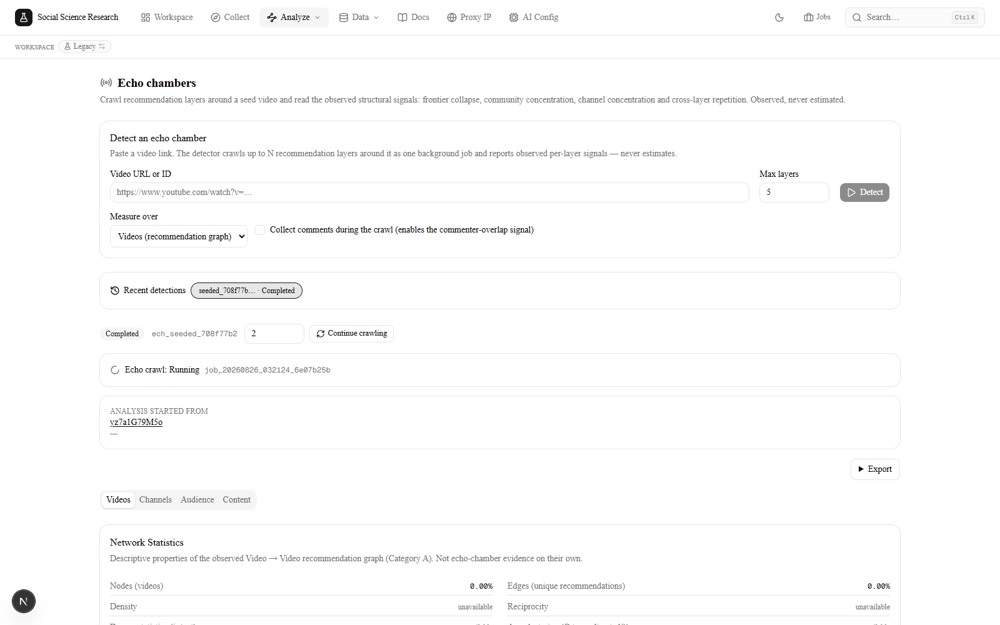
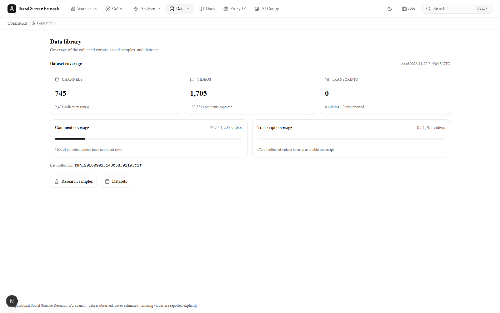
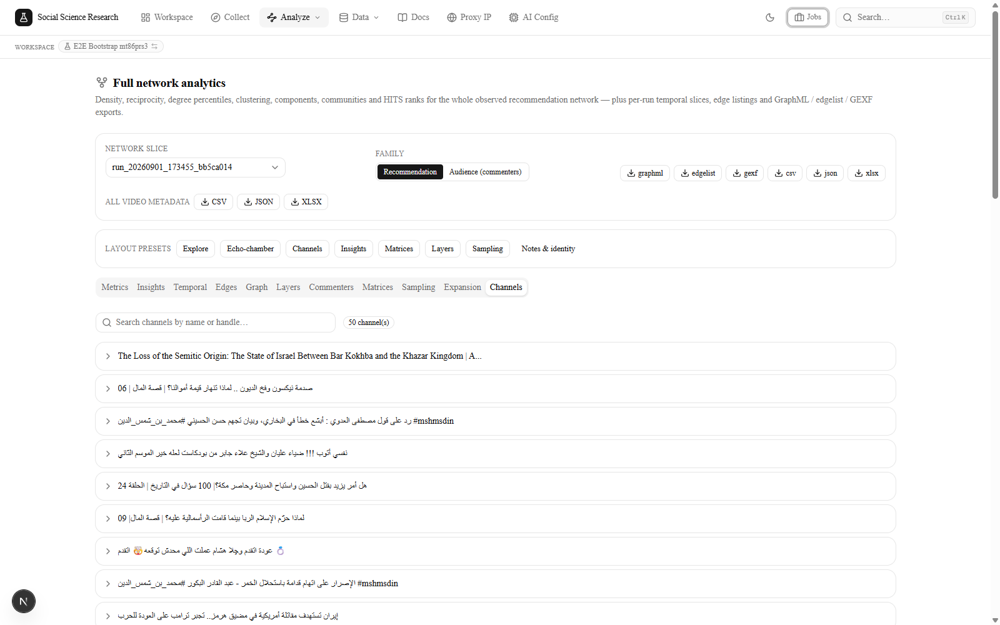
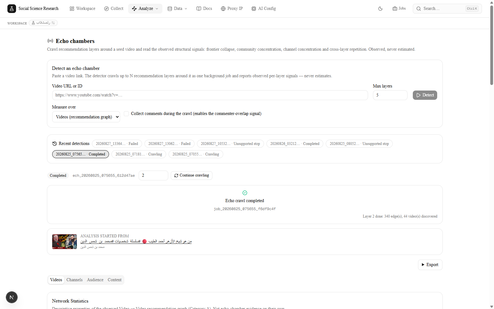

# The CSocial Science Lab — Computational Social Science Research Platform

> A research-engineering artifact for investigating platform-mediated information environments through joint analysis of social interaction, content semantics, recommendation structures, and community dynamics on YouTube.


*The full pre-refactor README (≈1540 lines) is preserved verbatim at [`README.full.backup.md`](README.full.backup.md). Nothing of substance was discarded — it was moved into the documentation system and linked below.*

---

## What this project is

Contemporary platforms are simultaneously social environments, content-distribution systems, recommendation engines, and information landscapes — interleaved forces that shape exposure, community formation, and information access. This project implements the computational infrastructure to study them: a research workbench that constructs and jointly examines **three network representations of YouTube data** — a social interaction network from commenter co-participation, a semantic content network from transcript embeddings, and a platform-mediated recommendation network from observable recommendation pathways — within a single environment, enabling cross-network comparison, community interaction analysis, and echo-chamber detection through five observable signals.

Three cooperating systems live in one repository: **A. CSS Research Workbench** (`SocialScienceResearch/`) — YouTube acquisition, network analysis, echo-chamber detection, export across 166 documented API paths; **B. Graph-RAG Intelligence Agent** (`RetrievalPipeline/`) — LangGraph state machine for identity → subject → audience → ecosystem analysis; **C. Ingestion Pipeline** (`Ingestion_Pipline/`) — Tavily crawl, chunk, embed (Gemini), Qdrant store. Details: [Architecture](docs/for-developers/architecture.md).

## Screenshots and corpus numbers

The captures below are from the **Legacy workspace**: 2,431 collection runs,
1,705 videos, 153,531 comments and 39 projects. Counters are per workspace — an
installation can hold many isolated workspace databases. Summed over **every
workspace database in this installation**:

| Measure | Legacy workspace (shown in screenshots) | All workspace databases |
|---|---:|---:|
| Collection runs | 2,431 | 3,040 |
| Channels | 745 | 1,473 |
| Videos | 1,705 | 3,794 |
| Comments | 153,531 | 297,683 |
| Projects | 39 | 44 |
| Recommendation edges | 46,442 | 67,604 |
| Datasets | 895 | 896 |
| Transcripts | 0 | 846 |

Coverage is reported, never silently assumed: in Legacy, 267 of 1,705 videos
(16%) have comment rows and 0 have an available transcript. The figures above
were read directly from the databases on 2026-11-20; workspace data changes as
runs are collected.

**Headline echo-chamber result** — the two-layer crawl produced a 2,447-node
video graph with **6,500 unique recommendation edges**:



Projection details: [Performance Optimizations](docs/for-developers/performance-optimizations.md).

| Workspaces | Full recommendation network |
|---|---|
|  |  |

| Echo signals | Data library coverage |
|---|---|
|  |  |

| Two-layer crawl job | Echo detection |
|---|---|
|  |  |

Browse every screen in the [catalogue](docs/screenshots/README.md) or scroll
through the [full one-page gallery](docs/screenshots/GALLERY.md). The earlier
walkthrough with prose captions is [docs/screenshots.md](docs/screenshots.md).

## Why it exists

Single-network analysis is methodologically insufficient, and the insufficiency is precise:

| Network Type | Reveals | Cannot By Itself Reveal |
|---|---|---|
| Social network | Who interacts with whom | What content is being discussed |
| Semantic/content network | Which content is related | Who is interacting around that content |
| Recommendation network | Which videos the platform connects | Whether users consume those recommendations |

A researcher studying only social structure cannot see whether the platform's recommendations bridge separated communities; studying only recommendations cannot see whether users engage across them; studying only content similarity cannot see either wiring. The relationships *between* these perspectives are themselves the object of study — so the infrastructure builds all three and compares them. Full statement: [Research Features](docs/for-researchers/research-features.md), [Methodology](docs/for-researchers/methodology.md).

Critically, collection is **context-aware**: account/session cookies, browser impersonation, proxy-based network positioning, and scraping profiles are controlled experimental variables — the same content observed under different user or geographic contexts yields comparable recommendation environments, not one blind scrape. See [Context-Aware Acquisition](docs/pipelines/context-aware-acquisition.md).

## What makes the approach interesting

**Structure × meaning, measured independently.** Traditional network analysis reveals the shape of relationships but not what the nodes mean. Instead of asking a (probabilistic, expensive, context-limited) LLM to classify transcripts, the flagship [content-homophily pipeline](docs/pipelines/content-homophily.md) projects transcripts to vectors with an embedding model (deterministic given model + input + config), mean-pools chunk embeddings to one vector per video, and compares videos arithmetically — cosine similarity within vs between Louvain communities (`seed=42`), tested against a label-permutation null (z-score, p-value). Structural separation can then be checked against semantic separation: do communities that the wiring separates also *talk about different things*? The distinction is characterized in [Structure vs Meaning](docs/concepts/structure-vs-meaning.md):

```
cos(u,v) = (u · v) / (‖u‖ ‖v‖)        u,v = mean-pooled video vectors
observed = within_mean − between_mean  (+ permutation null, z, p)
```

Nothing in the measurement path generates text or judges content — similarity is computed, not generated. That boundary (learned projection vs deterministic arithmetic vs generative agents) is enforced across all [Pipelines](docs/pipelines/index.md). The author's Medium write-up of this method is [Embedding Models Beyond RAG: A Network Science Experiment](https://medium.com/everyday-ai/embedding-models-beyond-rag-a-network-science-experiment-de9778eff684).

## Major achievements and capabilities

- **Recommendation-network crawler**: BFS layered expansion with frontier classification (`NEW_VIDEO / EXISTING_VIDEO / NEW_CHANNEL / CONNECTED / DISCONNECTED`), per-layer `LayerRun` provenance; 6,500+ videos across 2+ layers with 0 failures/blocks; enrichment 33s → 2.8s (~12x via `/next` bypass). → [Recommendation Crawling](docs/pipelines/recommendation-crawling.md)
- **Five echo-chamber signals (S1–S5)** from observed edges only — frontier collapse, seed-community concentration, top-channel share, cross-layer repetition, commenter-overlap reinforcement — each `available | unavailable` (never zero-filled), composite = renormalized weighted mean (`0.35/0.30/0.20/0.15/0.15`), missing core signal ⇒ `inconclusive`. → [Echo-Chamber Detection](docs/for-researchers/echo-chamber.md)
- **Two-layer recommendation crawl (case study)**: `job_20260901_163631_76aae01d` — 284 runs, 6,784 videos discovered, **6,500 succeeded**, 0 failures, with per-layer provenance. The optimized channel projection cut unattributed edges from **1,138 to 111** (46% → 5% of edges). → [Performance details](docs/for-developers/performance-optimizations.md) · [Jobs screenshot](docs/screenshots/27-jobs-two-layer.png)
- **Content-homophily infrastructure**: transcript reuse-first acquisition, `8000/200` chunking, cached mean-pooled embeddings, balanced/stratified pair sampling, bounded replacement, permutation null testing. → [Content-Homophily Pipeline](docs/pipelines/content-homophily.md)
- **Full SNA battery**: density, reciprocity, clustering, 10 centralities, Louvain (`seed=42`), roles, PageRank/HITS, channel projection (95% edge survival), 6 export formats — Karate-Club-validated to 1e-6. → [Network Science](docs/for-researchers/network.md)
- **Reproducibility as architecture**: `seed=42` everywhere, immutable samples with recipes (17 strategies), content-hash embedding cache, `collection_run_id` provenance, CI-guarded OpenAPI contract, 939 unit + 71 E2E tests. → [Reproducibility](docs/for-researchers/reproducibility.md)
- **Honesty principles**: observed, never estimated; deterministic; validated; contract is law. Availability typing (`available | missing | unsupported`) propagates through every mean, composite, and verdict. → [Limitations](docs/for-researchers/limitations.md)

## High-level methodology

Research Problem → Data Collection (context-controlled, three-layer fallback) → Semantic Representation (chunk → embed → mean-pool) → Graph Construction (directed + co-comment + channel projection) → Community Analysis (Louvain, conductance, WCR, nulls) → Recommendation Analysis (layers, PageRank) → Cross-Network Analysis (merge, matrices, homophily) → Statistical Analysis (permutation, z/p) → Research Evidence (always with provenance + availability). The end-to-end flow with per-pipeline detail: [Pipelines](docs/pipelines/index.md). Operationalization table (concept → computation → file): [Methodology](docs/for-researchers/methodology.md).

## Important outputs

- Recommendation / co-comment / channel graphs with communities, centralities, structural metrics, and 6-format export
- Within-vs-between semantic similarity with null-model significance (z, p, coverage, effect size)
- S1–S5 echo-chamber report: per-signal values + detail, composite score, verdict band, per-layer timeline
- Commenter-overlap / bridge-commenter analysis, community interaction matrices, network merges
- Longitudinal deltas, period/cohort comparisons; LangGraph intelligence reports (identity/subject/audience/ecosystem); Qdrant semantic search over ingested web content

## Major limitations (abridged)

Co-commenting is indirect (no lurkers, no reply quality); embeddings are topical, not ideological, and model-relative; recommendation edges are platform snapshots under one context (not user behavior); sampling fractions bound cost, not bias; Louvain `seed=42` is one partition among many; observational data cannot establish causation — structural patterns are consistent-with, never proof-of, echo chambers or polarization. Consolidated: [Limitations](docs/for-researchers/limitations.md).

## Documentation map

| Start here | You get |
|---|---|
| [Documentation index](docs/index.md) | Landing page with three tracks (recruiters / researchers / developers) |
| [Research Features](docs/for-researchers/research-features.md) | The 11 scientifically distinctive capabilities — what's actually novel |
| [Structure × Meaning](docs/concepts/structure-vs-meaning.md) | The core methodological distinction |
| [Pipelines](docs/pipelines/index.md) | End-to-end processing and analytical workflows, incl. the flagship [content-homophily pipeline](docs/pipelines/content-homophily.md) |
| [Methodology](docs/for-researchers/methodology.md) | How concepts become computation (canonical per-method detail) |
| [Echo-Chamber Detection](docs/for-researchers/echo-chamber.md) | S1–S5 formulas, composite scoring, verdict bands |
| [Network Science](docs/for-researchers/network.md) | Graph families, weight grammar, centrality, communities |
| [Sampling](docs/for-researchers/sampling.md) · [Reproducibility](docs/for-researchers/reproducibility.md) · [Ethics](docs/for-researchers/ethics.md) | Selection, determinism, scope |
| [Architecture](docs/for-developers/architecture.md) · [API Reference](docs/for-developers/api-reference.md) · [Quickstart](docs/for-developers/quickstart.md) | Software structure, 166 documented paths, 5-minute setup |
| [Screenshots](docs/screenshots/README.md) · [Full gallery](docs/screenshots/GALLERY.md) | Per-screen catalogue and every capture in one scroll |

> **Researcher path:** README → Research Features → Structure × Meaning → Pipelines → Methodology → Limitations → Research directions.
> **Developer path:** README → Quickstart → Architecture → API Reference → Pipelines → code paths in each pipeline doc.

## Installation / getting started (abridged)
## Pre-Run Requirements & Research Ethics

Before running the project, ensure that all required API keys, credentials, and configuration settings have been correctly installed and configured.

**Research ethics and responsible data collection are mandatory.** Before initiating any data collection, researchers must consider applicable research ethics requirements, institutional review procedures, platform Terms of Service, privacy regulations, and relevant data-protection laws.

Researchers are responsible for ensuring that their data collection and subsequent processing respect user privacy, data minimization, and the intended research scope. They must also ensure that their collection methods are appropriate and permitted for the intended study.

The availability of a technical collection method does not imply ethical approval, legal authorization, or permission from the platform. Researchers must obtain any required approvals and ensure that data collection, storage, processing, sharing, and publication comply with applicable ethical and legal standards.

```bash
git clone https://github.com/Ahmed-yasser86/The_CSocial_Science_Lab.git
cd The_CSocial_Science_Lab
uv sync
docker compose up -d                      # PostgreSQL
cp .env.example .env                      # add OPENAI_API_KEY, TAVILY_API_KEY (minimum)
# Optional: SOCIAL_TRANSCRIPT_PROVIDER=freetranscriptapi + FREETRANSCRIPTAPI_KEY for 10x transcripts
uvicorn SocialScienceResearch.api:create_app --factory --host 0.0.0.0 --port 8000
cd SocialScienceResearch/ui && npm install && npm run dev
mkdocs serve                                # docs site
pytest                                      # 939 unit + 71 E2E
```

Full runbook: [Quickstart](docs/for-developers/quickstart.md) · [Configuration](docs/for-developers/configuration.md). Researcher workflow (question → collect → sample → networks → communities → compare → echo signals → export → report honestly): [Methodology](docs/for-researchers/methodology.md) and the recruiter [Case Study](docs/for-recruiters/case-study.md).

## Research opportunities enabled (not completed work)

Longitudinal recommendation evolution; cross-community exposure and recommendation bridges; semantic-vs-structural polarization; community isolation; controlled comparative studies; larger datasets; other platforms; behavioral validation of structural findings. The system is the instrument; findings require data + analysis + interpretation. Full list: [Methodology](docs/for-researchers/methodology.md) (Research Opportunities) and [Research Features](docs/for-researchers/research-features.md) §11.

## Citation · License

See [Researchers → Citation](docs/for-researchers/citation.md) (`CITATION.cff` at repo root). MIT.
