# Screenshots

Screenshots of the running workbench, captured against a live workspace with real
collected data. They are not mockups or staged fixtures: every number below is read
from the PostgreSQL corpus at capture time.

## Workspaces

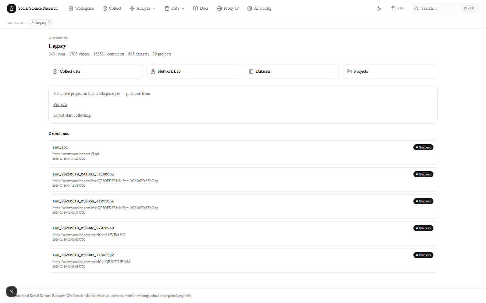

Each workspace is a fully isolated environment with its own database and data
directory. The cards show volume counters computed per workspace — the `Legacy`
workspace holds 2,431 collection runs, 1,705 videos, 895 datasets and 39 projects.

## Projects

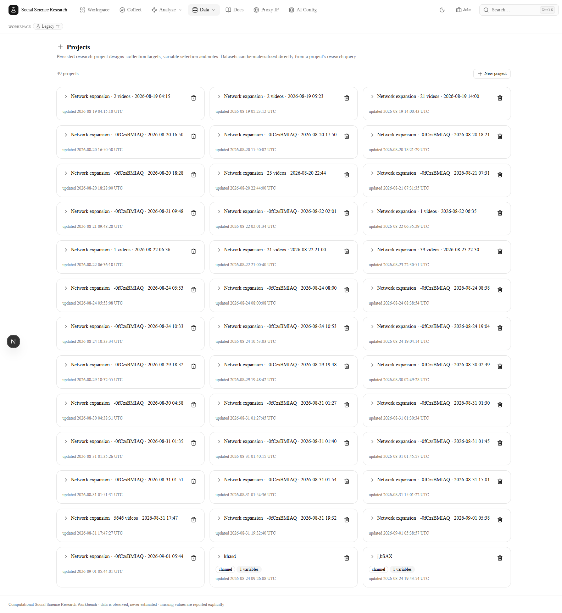

Persisted research-project designs: collection targets, variable selection and
notes. Datasets can be materialized directly from a project's research query.

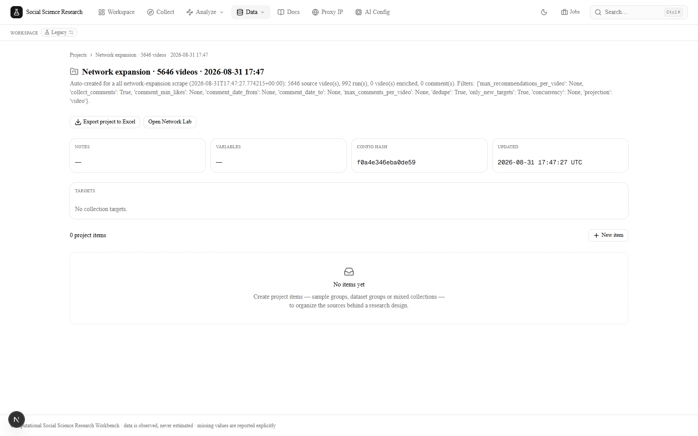

A single project record — here an auto-created network-expansion design covering
5,646 source videos, with its configuration hash and update timestamp preserved
for provenance.

## Analyze

The **Analyze** menu holds seven sub-tabs, each a different lens on the same
persisted corpus.

### Overview

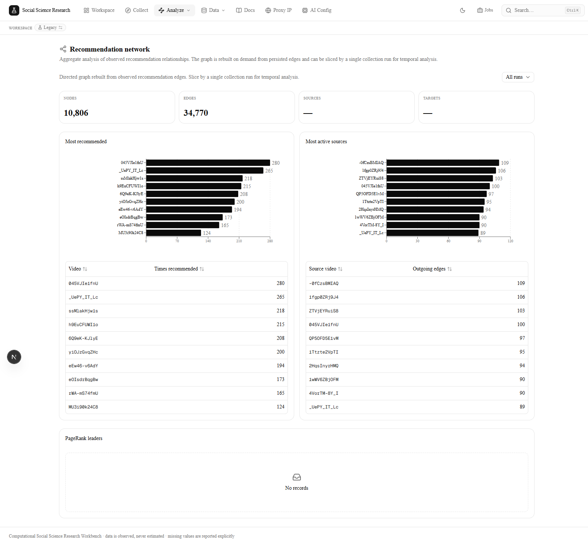

Aggregate recommendation network rebuilt from persisted edges: 10,806 nodes and
34,770 edges, with the most-recommended videos and most-active source videos
ranked side by side.

### Lab

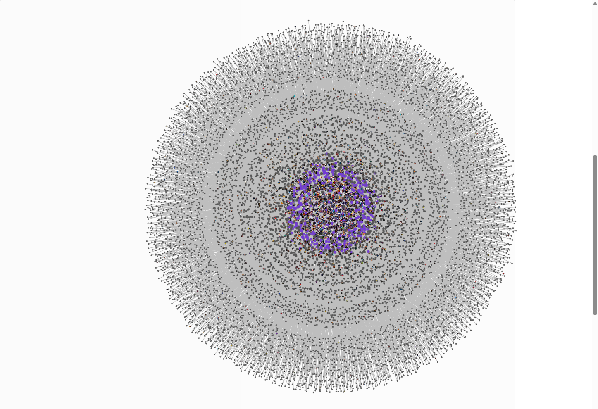

The Network Lab renders the full observed recommendation network — 10,806 nodes,
colored by role (focus videos, recommends/recommended, connected videos), with
Louvain communities listed above the canvas.

!!! note "Screenshot framing"
    The graph panel in the application is 480 px tall while the force-graph canvas
    is 1000 px, so the network is clipped in the default viewport. This image was
    captured with the panel expanded in the browser so the whole layout is visible.
    No application code was changed to produce it.

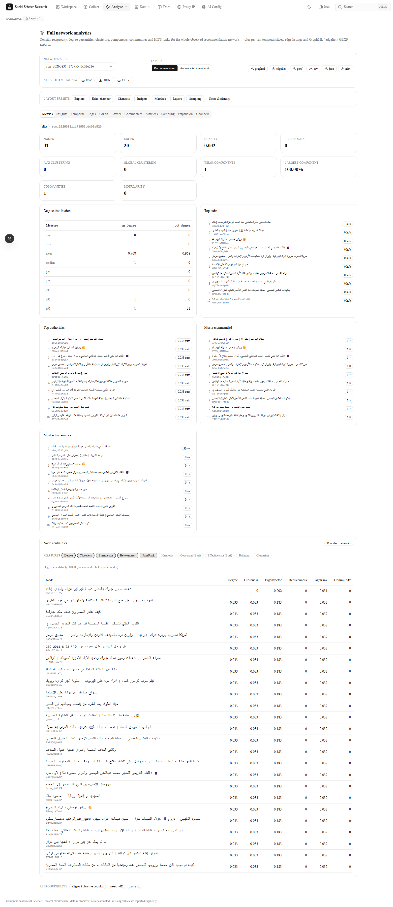

Structural metrics for a single run slice: density, reciprocity, weak components,
degree distribution percentiles, top hubs/authors/sources, and the per-node
centrality table (degree, closeness, eigenvector, betweenness, PageRank, harmonic,
effective size, bridging, clustering).

### Echo Chambers

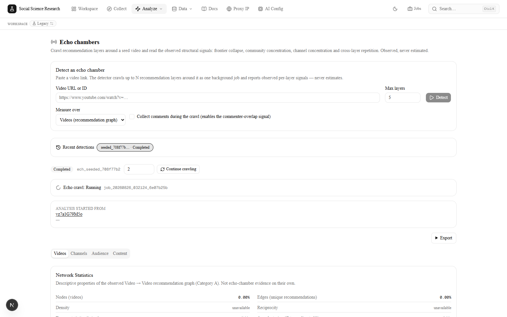

Crawl recommendation layers around a seed video and read the observed structural
signals — frontier collapse, community concentration, channel concentration and
cross-layer repetition. Signal values are reported only once a crawl completes;
until then they read `unavailable` rather than `0`.

### Commenters

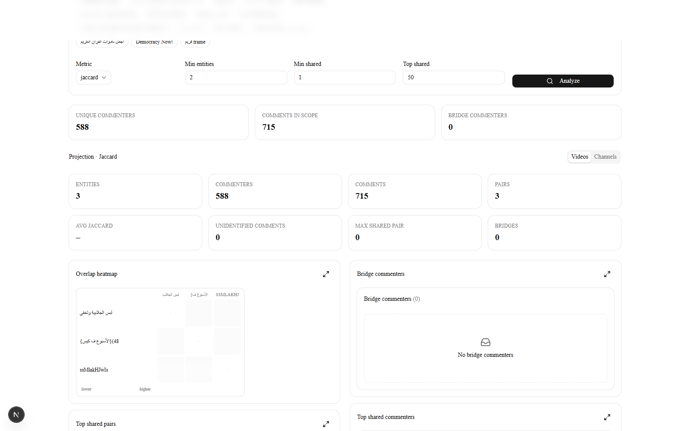

Shared-audience analysis over a video scope: 588 unique commenters, 715 comments
in scope, Jaccard projection across 3 entities and 3 pairs, an overlap heatmap and
a bridge-commenter panel.

### Compare

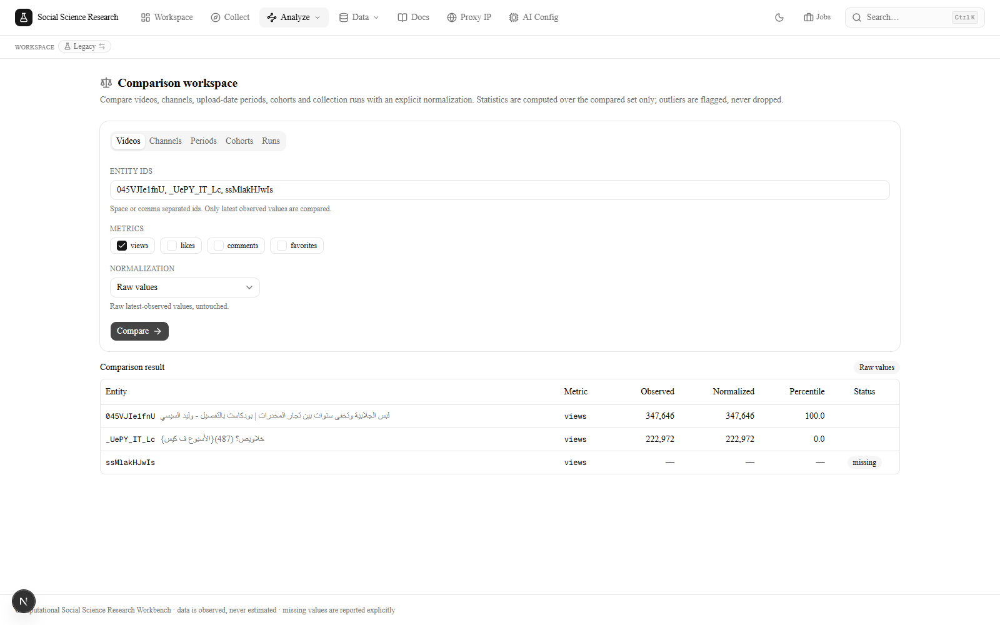

Side-by-side comparison of videos, channels, upload-date periods, cohorts or
collection runs under an explicit normalization. Missing observations are labelled
`missing` and excluded from the statistics rather than imputed.

### Query

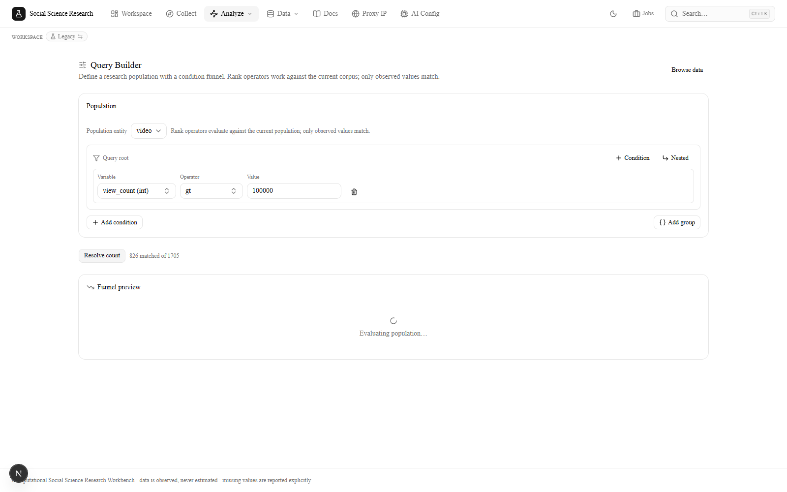

A condition funnel over the current population: `view_count > 100000` matches 826
of 1,705 videos, and the funnel preview reports exactly how many rows each
condition dropped and kept.

### Explorer

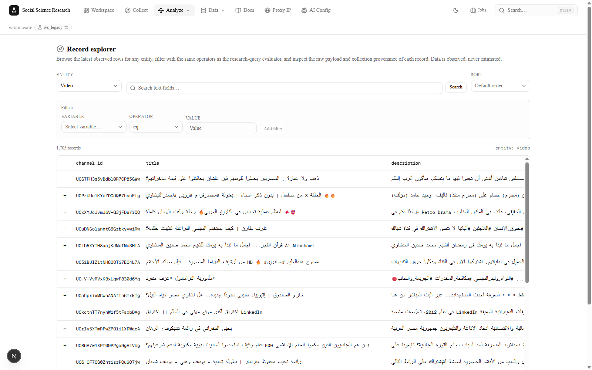

The record explorer browses the latest observed rows for any entity — here all
1,705 videos — with the same operators as the query evaluator, plus per-record
collection provenance.

## Data and provenance

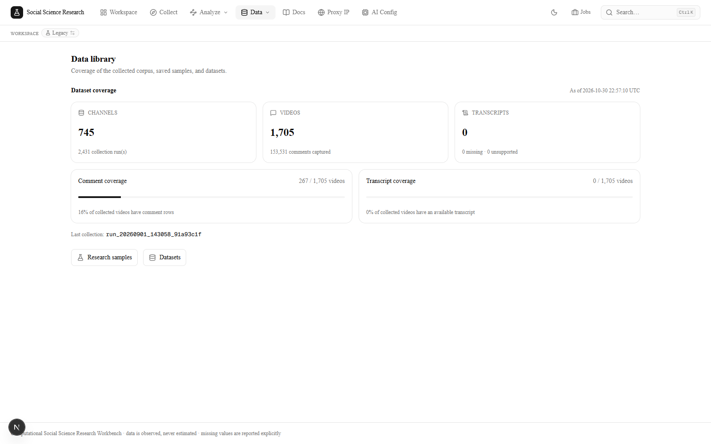

Coverage of the collected corpus: 745 channels, 1,705 videos, 153,531 comments,
with comment and transcript coverage reported explicitly as fractions rather than
silently omitted.

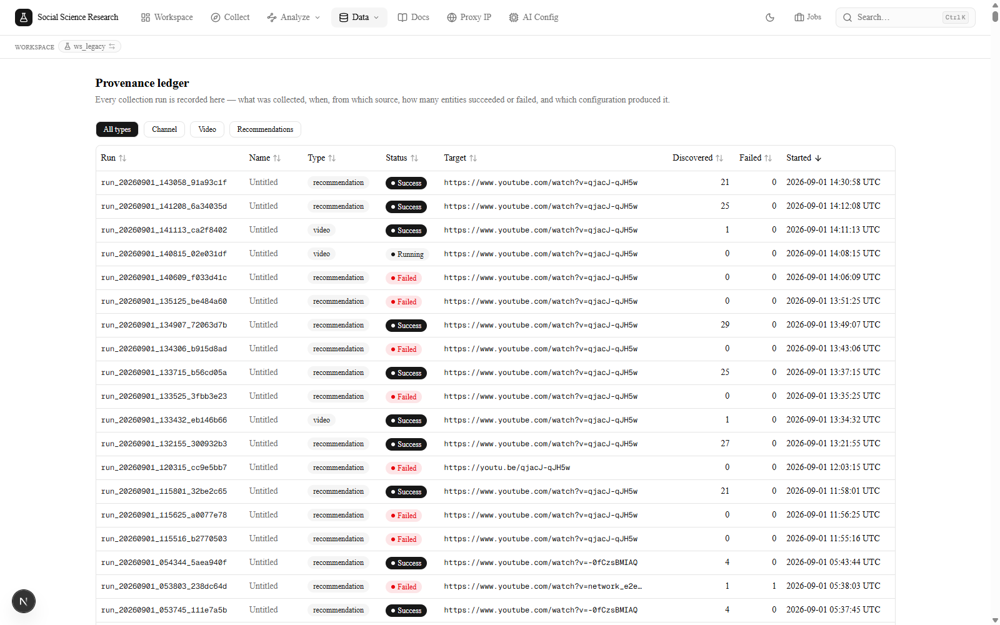

The provenance ledger records every collection run — what was collected, when,
from which source, how many entities succeeded or failed, and which configuration
produced it.

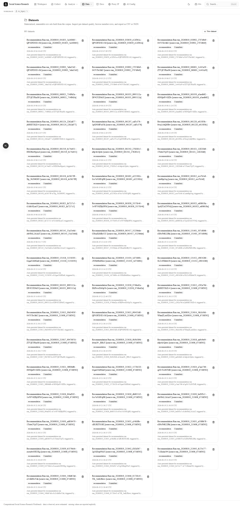

The dataset catalogue. Datasets are immutable row sets built from the corpus and
can be inspected per dataset for quality, browsed by member rows, and exported as
CSV or JSON.

## Reproducing these screenshots

```bash
# 1. Start PostgreSQL and the backend
docker compose up -d
uvicorn SocialScienceResearch.api:create_app --factory --host 0.0.0.0 --port 8000

# 2. Start the UI
cd SocialScienceResearch/ui && npm run dev

# 3. Open http://localhost:3000 and pick a workspace
```

Screenshots were captured at a 1600 × 1000 viewport in light mode. The exact
numbers shown depend on the workspace you open; the figures above reflect the
`Legacy` workspace at the time of capture.
